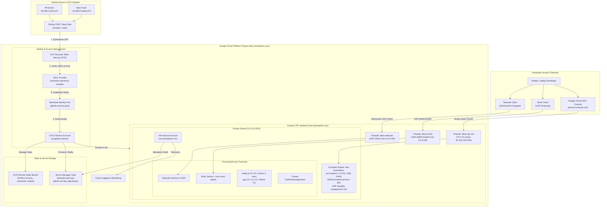

# Production IaC & CI/CD Cloud Mobile Workstation

An automated, enterprise-grade cloud developer workstation provisioned on Google Cloud Platform (GCP) with layered Terraform Infrastructure as Code (IaC) and GitHub Actions CI/CD authenticated via Google Cloud Workload Identity Federation (WIF).

Designed for low-latency, secure remote software engineering from mobile devices (iPads, laptops, smartphones) with zero direct internet attack surface.

---

## 1. System Architecture

The infrastructure separates concerns between a foundational bootstrap layer (`00-bootstrap`) and an application compute layer (`01-workstation`).

### Interactive Architecture Diagram



### Terminal-Friendly Network Topology

```
+-----------------------------------------------------------------------------+
|                          DEVELOPER CLIENT WORKSPACE                         |
|             (Laptop / iPad / Mobile Terminal / Remote Browser)              |
+-----------------------------------------------------------------------------+
         |                                    |                        |
         | WireGuard Tunnel (UDP 41641)       | Mosh (UDP 60000-61000) | IAP Tunnel
         | (Zero-Trust Tailscale SSH)         | (Interactive Roaming)  | (Break-Glass)
         v                                    v                        v
+-----------------------------------------------------------------------------+
|                      GOOGLE CLOUD PLATFORM (us-central1)                     |
|                                                                             |
|  +-----------------------------------------------------------------------+  |
|  | CUSTOM VPC NETWORK (rdw-workstation-vpc / 10.10.0.0/24)                |  |
|  |                                                                       |  |
|  |  +-----------------------------------------------------------------+  |  |
|  |  | Compute Engine: rdw-workstation (e2-medium: 2 vCPU, 4GB RAM)    |  |  |
|  |  | OS: Ubuntu 24.04 LTS | Storage: 50GB pd-balanced SSD            |  |  |
|  |  | Memory Tuning: 4GB Swapfile | swappiness=10 | cache_pressure=50 |  |  |
|  |  |                                                                 |  |  |
|  |  | Host Tooling:                                                   |  |  |
|  |  |   - Tailscale 1.x (Tailscale SSH enabled, keyless IdP auth)     |  |  |
|  |  |   - Mosh 1.4+ with defensive tmux safe auto-attach (.bashrc)    |  |  |
|  |  |   - Node.js 22 LTS, Python 3 venv, agy CLI (v1.4.12), GitHub gh |  |  |
|  |  |   - Target Workspace: ~/workspace/FireMonitoringSystem          |  |  |
|  |  +-----------------------------------------------------------------+  |  |
|  |            ^                                   ^                      |  |
|  +------------|-----------------------------------|----------------------+  |
|               | Runtime Service Account           | Metadata Token OAuth    |
|               | (sa-workstation-vm)               | (roles/secretAccessor)  |
|               v                                   v                         |
|  +---------------------------+       +-----------------------------------+  |
|  | Cloud Logging & Metrics   |       | Secret Manager (Secret Vault)     |  |
|  | (roles/logging.logWriter) |       | - tailscale-auth-key              |  |
|  | (roles/monitoring.writer) |       | - github-ssh-private-key          |  |
|  +---------------------------+       | - github-pat-token                |  |
|                                      +-----------------------------------+  |
|                                                           ^                 |
+-----------------------------------------------------------|-----------------+
                                                            | State & Secrets
+-----------------------------------------------------------|-----------------+
| GITHUB ACTIONS CI/CD AUTOMATION                           |                 |
|                                                           |                 |
|  +--------------------+         +---------------------+   |                 |
|  | Pull Request       |         | Push to main        |   |                 |
|  | terraform-plan.yml |         | terraform-apply.yml |   |                 |
|  +--------------------+         +---------------------+   |                 |
|            |                               |              |                 |
|            v                               v              |                 |
|  +----------------------------------------------------+   |                 |
|  | Keyless OIDC Authentication (google-github-auth@v2)|   |                 |
|  | Workload Identity Pool: github-actions-pool        |   |                 |
|  | Provider: github-provider (scoped to repository)   |---|                 |
|  | Impersonated SA: sa-github-actions                 |   |                 |
|  | Remote State: gs://<state-bucket>/terraform/state  |---+                 |
|  +----------------------------------------------------+                     |
+-----------------------------------------------------------------------------+
```

---

## 2. Zero-Trust Security Architecture

### Total Prohibition of Public SSH (`0.0.0.0/0:22`)
Standard cloud instances exposing port 22 directly to `0.0.0.0/0` are subject to relentless internet scanner reconnaissance, dictionary brute-force attacks, and zero-day vulnerabilities in OpenSSH (e.g., CVE-2024-6387 *regreSSHion*). 

In this architecture, **direct TCP port 22 ingress from the public internet is strictly blocked by VPC firewall rules**. The workstation presents no publicly discoverable listening SSH daemon.

### Tailscale WireGuard Mesh & Keyless Tailscale SSH
- **Encrypted Peer-to-Peer Mesh**: Traffic between the developer client and the workstation is encapsulated in authenticated, end-to-end encrypted WireGuard tunnels on UDP port 41641.
- **Tailscale SSH Authentication**: Rather than managing static SSH keypairs in `~/.ssh/authorized_keys`, access authorization is handled at the network layer by Tailscale. Authentication is bound to the identity provider (IdP) supporting multi-factor authentication (MFA) and central session revocation.
- **NAT Traversal & Roaming**: Direct connection via DERP servers and STUN enables seamless handoff when switching between cellular and Wi-Fi networks on mobile devices.

### Google Cloud Identity-Aware Proxy (IAP) Break-Glass Ingress
In the event that the Tailscale daemon crashes, certificates expire, or network configuration drifts, an out-of-band **break-glass access path** is preserved through Google Cloud Identity-Aware Proxy (IAP):
- Firewall rule `allow-iap-ssh` permits TCP port 22 ingress **strictly from the Google Cloud IAP netblock `35.235.240.0/20`**.
- Access requires authenticated Google IAM credentials with `roles/iap.tunnelResourceAccessor` and `roles/compute.osLogin`.
- Connections are proxied over TLS through Google's edge infrastructure using `gcloud compute ssh --tunnel-through-iap`.

### Workload Identity Federation (WIF) vs Static Service Account Keys

Traditional CI/CD pipelines store long-lived Google Cloud Service Account JSON keys in GitHub Secrets. This anti-pattern introduces severe security liabilities:
- **Zero Automated Rotation**: Keys persist indefinitely until manually rotated.
- **Exfiltration Vulnerability**: Secrets exposed in build logs or stolen via malicious dependencies allow persistent access from any IP.
- **Enterprise Policy Violation**: Google Cloud Organization Policy `constraints/iam.disableServiceAccountKeyCreation` actively blocks creating static keys in compliant enterprise tenants.

#### Keyless OIDC Token Exchange Mechanics
Workload Identity Federation replaces static keys with short-lived, cryptographically verified tokens:

1. **OIDC Token Minting**: A GitHub Actions runner requests a short-lived JSON Web Token (JWT) from GitHub's OIDC issuer (`https://token.actions.githubusercontent.com`) with `id-token: write` permissions.
2. **Security Token Service (STS) Exchange**: The runner presents the JWT to the Google Cloud STS endpoint.
3. **Cryptographic Verification**: Google STS verifies GitHub's signature against GitHub's public JSON Web Key Sets (JWKS).
4. **Attribute Scoping & Condition Enforcement**: The Workload Identity Provider validates the attribute condition:
   ```hcl
   attribute_condition = "assertion.repository == '${var.github_repo}'"
   ```
   Workflows running on forks or unauthorized repositories are rejected.
5. **Short-Lived Impersonation**: STS returns a federated token that is exchanged via `iamcredentials.googleapis.com` for an ephemeral Google Cloud access token (TTL: 1 hour) impersonating `sa-github-actions`.

### Secret Manager Runtime Decoupling
Sensitive assets (Tailscale pre-authenticated keys, GitHub SSH deploy keys, and GitHub Personal Access Tokens) are **never committed to IaC or embedded in VM metadata**.
- Terraform creates empty Secret Manager containers (`tailscale-auth-key`, `github-ssh-private-key`, `github-pat-token`).
- Payloads are injected out-of-band via CLI.
- At VM initialization, the startup script calls the Compute Engine Metadata Server to obtain a runtime access token for `sa-workstation-vm`, fetching the secrets directly over HTTPS via the Secret Manager REST API:
  ```bash
  TOKEN=$(curl -s -H "Metadata-Flavor: Google" \
    "http://metadata.google.internal/computeMetadata/v1/instance/service-accounts/default/token" | jq -r .access_token)
  SECRET_PAYLOAD=$(curl -sf -H "Authorization: Bearer ${TOKEN}" \
    "https://secretmanager.googleapis.com/v1/projects/${PROJECT_ID}/secrets/${SECRET_NAME}/versions/latest:access" \
    | jq -r '.payload.data // empty' | base64 -d)
  ```

---

## 3. Financial Architecture & Memory Sizing Math

### Cloud Economics: Right-Sizing Compute
Developer workstations typically experience bursty activity: extensive typing and idle debugging punctuated by brief compilation or test runs. Over-provisioning compute resources for continuous operation leads to significant cloud waste.

| Machine Configuration | vCPU | RAM | Monthly Compute (`us-central1`) | Storage (50GB `pd-balanced`) | Estimated Total |
|---|---|---|---|---|---|
| **`e2-medium` (Chosen)** | **2 (Burstable)** | **4 GB** | **~$24.46 / month** ($0.0335/hr) | **~$5.00 / month** | **~$29.46 / month** |
| `e2-standard-4` | 4 (Dedicated) | 16 GB | ~$97.10 / month ($0.1330/hr) | ~$5.00 / month | ~$102.10 / month |
| `n2-standard-4` | 4 (Dedicated) | 16 GB | ~$142.35 / month ($0.1950/hr) | ~$5.00 / month | ~$147.35 / month |

By right-sizing to **`e2-medium`**, infrastructure costs are reduced by **over 70%** ($24/month vs $97/month), saving ~$870 annually per developer seat.

### 4GB Swapfile & Linux Kernel Memory Tuning
A standard `e2-medium` instance has 4 GB of physical memory. Heavy developer workflows (e.g. `npm install`, TypeScript transpilation, or running multiple microservices) can temporarily exceed 4 GB, triggering the Linux Out-Of-Memory (OOM) killer.

To achieve robust stability without upgrading to a cost-prohibitive instance tier, the VM implements a **4GB Swapfile** backed by low-latency `pd-balanced` SSD storage, coupled with aggressive kernel memory tuning:

```bash
# Sizing: 4GB physical RAM + 4GB swapfile = 8GB effective virtual address space
fallocate -l 4G /swapfile
chmod 600 /swapfile
mkswap /swapfile
swapon /swapfile
echo '/swapfile none swap sw 0 0' >> /etc/fstab
```

#### Kernel Virtual Memory Parameters (`/etc/sysctl.d/99-workstation.conf`)
- **`vm.swappiness = 10`** (Default: `60`): Instructs the Linux kernel to aggressively prioritize physical RAM for active processes. Pages are only written to the swapfile when memory utilization reaches ~90%, avoiding I/O thrashing and preserving interactive terminal responsiveness.
- **`vm.vfs_cache_pressure = 50`** (Default: `100`): Instructs the virtual memory subsystem to retain directory dentries and inode caches in memory longer. This drastically accelerates repetitive `git status`, `git diff`, and directory traversal operations across large workspaces like `FireMonitoringSystem`.

---

## 4. Workstation Environment & Tooling

The workstation VM bootstraps into a fully functional developer environment:

- **Operating System**: Ubuntu 24.04 LTS (Noble Numbat, amd64).
- **Mobile Shell (Mosh)**: UDP roaming on ports `60000-61000`, enabling packet loss tolerance and instant reconnection across network drops.
- **Terminal Multiplexer (tmux)**: Defensive auto-attach configured in `.bashrc` with session protection guards:
  ```bash
  # Safe Interactive Auto-Attach Guard (prevents breaking non-interactive SSH, scp, and VS Code IPC)
  if [ -t 0 ] && [ -z "$TMUX" ] && [ -z "$SSH_ORIGINAL_COMMAND" ] && [ -z "$VSCODE_IPC_HOOK_CLI" ]; then
      if command -v tmux >/dev/null 2>&1; then
          exec tmux new-session -A -s main
      fi
  fi
  ```
- **Language Runtimes**: Node.js 22 LTS (NodeSource) and Python 3 + `python3-venv`.
- **Developer Tooling**: Antigravity CLI (`agy v1.4.12`), GitHub CLI (`gh`), Git pre-configured with default branch `main`, `ripgrep`, `htop`, and build essentials.
- **Target Repository**: Pre-cloned `FireMonitoringSystem` ready for active development in `~/workspace/FireMonitoringSystem`.

---

## 5. Turnkey Deployment & Setup Guide

### Phase 0: Prerequisites
Install and authenticate the required local CLI tools:
```bash
# Required CLI utilities: terraform (>= 1.5.0), gcloud, gh, git
gcloud auth login
gcloud auth application-default login
gh auth login
```

### Phase 1: Local Bootstrap & State Migration
Run the automated bootstrap helper script from the repository root:
```bash
chmod +x scripts/bootstrap-local.sh
./scripts/bootstrap-local.sh
```

This 3-phase script executes:
1. **Pre-flight Validation**: Verifies active GCP billing and GitHub repository context.
2. **Local Provisioning**: Provisions the GCP project, enables core APIs, deploys the GCS state bucket, and sets up WIF pools and Service Accounts.
3. **State Migration**: Migrates local state to `gs://<bucket-name>/terraform/state/00-bootstrap` and exports required GitHub Actions variables (`GCP_PROJECT_ID`, `GCP_WORKLOAD_IDENTITY_PROVIDER`, `GCP_SERVICE_ACCOUNT`, `GCP_STATE_BUCKET`).

Commit the generated backend configurations:
```bash
git add terraform/00-bootstrap/backend.tf terraform/01-workstation/backend.tf
git commit -m "chore(terraform): configure remote GCS backend after bootstrap migration"
git push origin main
```

### Phase 2: Secret Injection
Populate runtime secrets into the provisioned Secret Manager containers:
```bash
PROJECT_ID=$(cd terraform/00-bootstrap && terraform output -raw project_id)

# 1. Tailscale Pre-Authenticated Key (reusable or single-use)
echo "tskey-auth-xxxxxx" | gcloud secrets versions add tailscale-auth-key --data-file=- --project="${PROJECT_ID}"

# 2. GitHub SSH Private Key (for git commit and push access)
gcloud secrets versions add github-ssh-private-key --data-file="${HOME}/.ssh/id_ed25519" --project="${PROJECT_ID}"

# 3. GitHub Personal Access Token (for gh CLI authentication)
echo "ghp_xxxxxx" | gcloud secrets versions add github-pat-token --data-file=- --project="${PROJECT_ID}"
```

### Phase 3: Continuous Integration & Deployment (CI/CD)

The repository provides two GitHub Actions workflows configured with Workload Identity Federation:

- **`terraform-plan.yml`**: Triggered on Pull Requests modifying `terraform/**`. Runs `terraform fmt -check`, `terraform validate`, and `terraform plan`, posting a structured, sticky comment with the plan output to the PR.
- **`terraform-apply.yml`**: Triggered on push/merge to `main`. Executes `terraform apply -auto-approve` against `01-workstation` with a strict concurrency mutex (`concurrency: production-deploy`, `cancel-in-progress: false`) to prevent simultaneous runs and state locking races.

### Phase 4: Workstation Connectivity & Verification

Once provisioned, connect using your preferred client:

```bash
# 1. Connect via Tailscale SSH (zero key management)
ssh ubuntu@cloud-workstation

# 2. Connect via Mosh over Tailscale (resilient mobile roaming)
mosh ubuntu@cloud-workstation

# 3. Break-Glass Connection via Google Cloud IAP
gcloud compute ssh rdw-workstation --zone=us-central1-a --tunnel-through-iap
```

#### Run Automated Health Verification
Inside the VM or remotely, execute the turnkey verification suite:
```bash
./scripts/verify-workstation.sh
```

The script audits:
- Swapfile allocation (4GB active) and kernel sysctl parameters (`swappiness=10`, `vfs_cache_pressure=50`).
- Tailscale daemon health and Tailscale SSH accessibility.
- Mosh and tmux auto-attach initialization.
- Node.js LTS, Python 3, and `agy` CLI binary execution.
- Workspace repository integrity for `FireMonitoringSystem`.

---

## 6. Repository Layout & Interface Contracts

```
remote-dev-workstation/
├── .github/
│   └── workflows/
│       ├── terraform-plan.yml       # PR validation with WIF & sticky comment
│       └── terraform-apply.yml      # Main push deployment with WIF & concurrency lock
├── terraform/
│   ├── 00-bootstrap/                # Foundational layer (Project, APIs, GCS, WIF, SAs, Secrets)
│   │   ├── main.tf
│   │   ├── variables.tf
│   │   ├── outputs.tf
│   │   ├── versions.tf
│   │   └── terraform.tfvars.example
│   └── 01-workstation/              # Compute layer (VPC, Subnet, Firewall, e2-medium VM)
│       ├── main.tf
│       ├── remote_state.tf          # Ingests 00-bootstrap outputs via terraform_remote_state
│       ├── startup.sh               # Hardened VM bootstrap script
│       ├── variables.tf
│       ├── outputs.tf
│       └── versions.tf
├── scripts/
│   ├── bootstrap-local.sh           # 3-phase bootstrap & state migration runner
│   ├── verify_m1_contract.sh        # Milestone 1 contract and security audit
│   └── verify-workstation.sh        # Milestone 2 & 4 programmatic verification suite
├── tests/                           # E2E Test Suite (Tiers 1–4)
│   ├── e2e_runner.sh
│   ├── tier1_feature_tests.sh
│   ├── tier2_boundary_tests.sh
│   ├── tier3_integration_tests.sh
│   └── tier4_workload_tests.sh
└── README.md                        # Portfolio-grade documentation
```

### Layer Interface Contract (`00-bootstrap` ↔ `01-workstation`)
- `01-workstation` consumes bootstrap outputs via `data "terraform_remote_state" "bootstrap"`.
- Consumed contract attributes:
  - `project_id`: Target GCP Project ID.
  - `workstation_service_account_email`: Runtime identity attached to the VM.
  - `state_bucket_name`: Remote state bucket for backend locking.
  - `wif_provider_name`: OIDC provider for CI/CD authentication.

---

## 7. Senior Platform / DevOps Interview Talking Points

### 1. Cloud Economics & Burstable Compute Architecture
- **Question**: *"Why choose an `e2-medium` with a swapfile instead of an `e2-standard-4` for development?"*
- **Talking Point**: An engineer's workday is mostly interactive typing and thought, during which 4 vCPUs and 16GB of RAM sit 95% idle. By combining an `e2-medium` ($24/month) with a 4GB swapfile on high-throughput `pd-balanced` SSDs and tuning `vm.swappiness = 10`, we absorb burst compilation memory spikes without paying a 400% premium for an `e2-standard-4` ($97/month).

### 2. Defense-in-Depth & Identity-Centric Zero-Trust
- **Question**: *"How do you secure developer access without exposing public SSH ports?"*
- **Talking Point**: We eliminate perimeter firewall reliance by shifting authorization to identity. TCP port 22 is completely blocked from `0.0.0.0/0`. Primary access uses Tailscale WireGuard mesh with Tailscale SSH, tying access directly to the corporate IdP. For emergency recovery, Google Cloud IAP acts as a zero-trust proxy restricted to Google's internal CIDR `35.235.240.0/20`, requiring IAM OS Login authorization.

### 3. Supply Chain Security & Ephemeral CI/CD Credentials
- **Question**: *"Why use Workload Identity Federation instead of GitHub Secrets for GCP credentials?"*
- **Talking Point**: Long-lived service account keys are one of the most common vectors for cloud account compromises. They lack automated rotation, cannot be centrally audited for leakage, and violate GCP Organization Policy `constraints/iam.disableServiceAccountKeyCreation`. WIF leverages cryptographic OIDC token exchange with GitHub's token mint, granting short-lived (1-hour) tokens scoped strictly to the authentic repository (`assertion.repository == 'Fauxx/remote-dev-workstation'`).

### 4. Non-Authoritative IAM & Least-Privilege Blast Radius
- **Question**: *"Why use `google_project_iam_member` instead of `google_project_iam_policy` or `google_project_iam_binding`?"*
- **Talking Point**: Authoritative IAM bindings in Terraform overwrite all unmanaged permissions on the project, creating risk of locking out administrators or revoking critical platform roles. Using additive `google_project_iam_member` ensures that each component's permissions are managed without destroying foreign grants. Furthermore, the VM's runtime service account is granted zero compute or storage administration roles, only least-privilege telemetry (`logging.logWriter`, `monitoring.metricWriter`) and scoped Secret Manager access.

### 5. Safe Interactive Shell Initialization
- **Question**: *"How did you prevent tmux auto-attach from breaking non-interactive tool chains?"*
- **Talking Point**: Blindly executing `exec tmux` in `.bashrc` breaks automated tools like `rsync`, `scp`, `sftp`, git remote hooks, and VS Code Remote SSH server setup. We implemented a defensive shell guard: `[ -t 0 ]` ensures stdin is an interactive TTY, `[ -z "$TMUX" ]` prevents recursive tmux loops, `[ -z "$SSH_ORIGINAL_COMMAND" ]` preserves one-off SSH command execution, and `[ -z "$VSCODE_IPC_HOOK_CLI" ]` avoids breaking IDE remote connection daemons.
